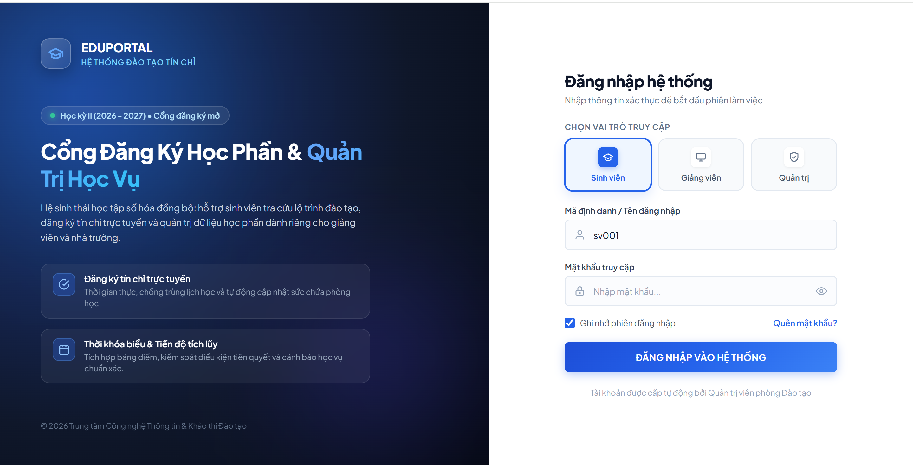

# HỆ THỐNG QUẢN LÝ KHÓA HỌC VÀ ĐĂNG KÝ HỌC PHẦN (STUDENTHUB)

## 1. Thông tin chung

- **Tên dự án:** StudentHub
- **Môn học:** Lập trình Web
- **Chủ đề:** Chủ đề 1
- **Loại dự án:** Bài tập lớn theo nhóm
- **Công nghệ sử dụng:** PHP 8.x, MySQL, PDO, MVC, HTML5, CSS3, JavaScript, Fetch API
- **Mục tiêu:** Xây dựng hệ thống hỗ trợ quản lý học phần, đăng ký lớp học phần và quản lý thông tin theo từng vai trò người dùng.
- ** Thành viên nhóm:
+ Phạm Ngọc Anh : Nhóm trưởng 
+ Nguyễn Thị Thu Huyền
+ Nguyễn Thị Kim Anh 
+ Tạ Như Quỳnh 
+ Lê Khánh Ly

## 2. Giới thiệu dự án

StudentHub là hệ thống quản lý khóa học và đăng ký học phần được xây dựng nhằm hỗ trợ sinh viên, giảng viên và quản trị viên thực hiện các công việc liên quan đến quản lý học phần.

Hệ thống được phát triển bằng PHP và MySQL theo mô hình MVC, sử dụng PDO để kết nối cơ sở dữ liệu và JavaScript, Fetch API để xử lý các tương tác trên giao diện.

Dự án hướng đến giao diện hiện đại, dễ sử dụng, có khả năng thích ứng với nhiều kích thước màn hình và bảo đảm các chức năng phù hợp với từng vai trò.

## 3. Mục tiêu và chức năng chính

### 3.1. Đăng nhập và phân quyền

- Cung cấp giao diện đăng nhập cho sinh viên, giảng viên và quản trị viên.
- Kiểm tra thông tin đăng nhập ở cả phía JavaScript và phía máy chủ PHP.
- Xác định vai trò người dùng sau khi đăng nhập thành công.
- Lưu thông tin phiên đăng nhập bằng PHP Session.
- Điều hướng người dùng đến giao diện phù hợp với vai trò.
- Hỗ trợ ghi nhớ tên đăng nhập bằng LocalStorage khi người dùng lựa chọn.
- Hiển thị thông báo khi đăng nhập thành công hoặc thất bại.

### 3.2. Quản lý dành cho sinh viên

- Xem danh sách lớp học phần.
- Xem thông tin chi tiết của lớp học phần.
- Đăng ký lớp học phần theo chức năng được cung cấp.
- Xem danh sách học phần đã đăng ký.
- Theo dõi thông tin liên quan đến lịch học và học phần.

### 3.3. Quản lý dành cho giảng viên

- Xem danh sách lớp học phần được phân công.
- Xem thông tin chi tiết của lớp học phần.
- Theo dõi danh sách sinh viên đăng ký lớp học phần.
- Xem số lượng sinh viên đã đăng ký và thông tin lớp học.

### 3.4. Quản lý dành cho quản trị viên

- Quản lý tài khoản người dùng.
- Quản lý thông tin sinh viên và giảng viên.
- Quản lý học phần và lớp học phần.
- Quản lý các thông tin phục vụ hoạt động đăng ký học phần.
- Hỗ trợ kiểm soát dữ liệu chung của hệ thống.
## 4. Phân công nhiệm vụ các thành viên
- Nhóm trưởng: Thành viên 1 — Form đăng nhập
I. Nhóm trưởng: Thành viên 1 - Phạm Ngọc Anh — Form đăng nhập
- Hoàn thiện wireframe đăng nhập.
- Bố trí 3 vai trò: Sinh viên, Giảng viên, Quản trị viên.
- Mô tả các trường tài khoản, mật khẩu và nút đăng nhập.
- Xác định luồng đăng nhập thành công và thất bại.
- 
1. Mô tả các thành phần
- Sinh viên: 	Chọn vai trò sinh viên để đăng nhập
- Giảng viên:	Chọn vai trò giảng viên
- Quản trị viên:	Chọn vai trò quản trị hệ thống
- Tên đăng nhập:	Nhập tài khoản được cấp
- Mật khẩu: Nhập mật khẩu; có thể hiện hoặc ẩn
- Ghi nhớ tên đăng nhập:	Cho phép ghi nhớ tên đăng nhập trên thiết bị nếu triển khai chức năng này
- Quên mật khẩu:	Hướng dẫn khôi phục tài khoản
- Đăng nhập:	Gửi thông tin để hệ thống kiểm tra
2. Luồng đăng nhập thành công và thất bại
  
- Khi đăng nhập thành công, hệ thống phải xác minh vai trò và quyền của tài khoản ở phía máy chủ, không chỉ dựa vào vai trò người dùng tự chọn trên giao diện.

Thành viên 1 phụ trách thiết kế wireframe cho màn hình đăng nhập của hệ thống StudentHub. Giao diện gồm ba vai trò: Sinh viên, Giảng viên và Quản trị viên; trường nhập tên đăng nhập, mật khẩu và nút Đăng nhập. Ngoài ra, giao diện có thể bổ sung chức năng hiện/ẩn mật khẩu, ghi nhớ tên đăng nhập và hỗ trợ khi quên mật khẩu.
Luồng đăng nhập được chia thành hai trường hợp. Khi thông tin hợp lệ, hệ thống xác thực tài khoản, tạo phiên đăng nhập và điều hướng người dùng đến trang chức năng phù hợp với vai trò đã được xác minh. Khi thông tin không hợp lệ hoặc còn thiếu, hệ thống hiển thị thông báo lỗi và cho phép người dùng nhập lại.
Kết quả cần đạt là giao diện rõ ràng, dễ sử dụng, thống nhất về bố cục và xác định được các luồng xử lý thành công, thất bại để làm cơ sở cho việc lập trình và kiểm thử.

II. Thành viên 2 - Lê Khánh Ly – Luồng điều hướng
1. Nhiệm vụ được phân công
Thành viên 3 phụ trách xác định và xây dựng luồng điều hướng của hệ thống StudentHub sau khi người dùng đăng nhập. Nội dung tập trung vào việc xác định hướng điều hướng tương ứng với từng vai trò, bao gồm Sinh viên, Giảng viên và Quản trị viên, đồng thời xác định cách xử lý khi đăng nhập thành công, đăng nhập thất bại và đăng xuất khỏi hệ thống.
2. Mô tả luồng điều hướng
Sinh viên: Sau khi đăng nhập thành công và được hệ thống xác minh quyền truy cập, người dùng được điều hướng đến khu vực chức năng dành cho sinh viên.
Giảng viên: Sau khi đăng nhập thành công và được xác minh quyền, người dùng được điều hướng đến khu vực chức năng dành cho giảng viên.
Quản trị viên: Sau khi đăng nhập thành công và được xác minh quyền, người dùng được điều hướng đến khu vực quản trị hệ thống.
Đăng nhập thất bại: Hệ thống giữ người dùng tại trang đăng nhập và hiển thị thông báo khi tài khoản, mật khẩu không chính xác hoặc thông tin nhập vào chưa đầy đủ.
Đăng xuất: Hệ thống kết thúc phiên đăng nhập và đưa người dùng trở về trang đăng nhập.
Truy cập không hợp lệ: Hệ thống kiểm tra trạng thái đăng nhập và quyền của người dùng trước khi cho phép truy cập các khu vực chức năng, tránh việc truy cập trái phép.
3. Kết quả cần đạt
Xác định rõ luồng di chuyển giữa màn hình đăng nhập và các khu vực chức năng theo từng vai trò, tạo cơ sở cho việc triển khai lập trình và kiểm thử hệ thống. Việc điều hướng phải dựa trên vai trò đã được xác minh ở phía máy chủ, kết hợp với cơ chế quản lý phiên đăng nhập và kiểm tra quyền truy cập.
Ở giai đoạn demo hiện tại, thành viên 3 thực hiện xác định luồng điều hướng dự kiến theo ba vai trò. Việc chuyển đến các trang chức năng cụ thể sẽ được hoàn thiện khi các trang đích của hệ thống được xây dựng.

III. Thành viên 3 - Nguyễn Thị Thu Huyền — Validation đăng nhập
- Xác định các trường bắt buộc trên form đăng nhập: Vai trò đăng nhập, Tên đăng nhập và Mật khẩu.
- Quy định thông báo lỗi chi tiết khi người dùng bỏ trống hoặc nhập sai định dạng:
  + Bỏ trống tên đăng nhập hoặc mật khẩu: Hiển thị thông báo *"Vui lòng nhập tên đăng nhập/mật khẩu"* và đánh viền đỏ trường dữ liệu.
  + Tên đăng nhập không đúng định dạng: Kiểm tra độ dài (3-30 ký tự) và ký tự hợp lệ.
  + Mật khẩu không đạt yêu cầu: Yêu cầu tối thiểu 6 ký tự.
- Xác định cơ chế kiểm tra chéo vai trò và tài khoản ở cả phía Client (JavaScript) và Server (PHP):
  + Đối chiếu tên đăng nhập và mật khẩu với cơ sở dữ liệu/danh sách demo (hỗ trợ Sinh viên, Giảng viên và 3 tài khoản Quản trị viên).
  + Kiểm tra tính khớp lệnh giữa vai trò người dùng chọn trên giao diện và phân quyền thực tế của tài khoản đó trong hệ thống.
- Lập bảng các trường hợp kiểm thử (Test Cases) cho chức năng đăng nhập:
  + TC01: Bỏ trống toàn bộ các trường bắt buộc.
  

  + TC02: Nhập sai định dạng tên đăng nhập hoặc mật khẩu quá ngắn (<6 ký tự).
  

  + TC03: Sai thông tin tài khoản hoặc mật khẩu.

  + TC04: Chọn đúng tài khoản nhưng chọn sai vai trò đăng nhập.

  + TC05: Đăng nhập thành công với phân quyền hợp lệ (Sinh viên, Giảng viên, Quản trị viên).

IV. Thành viên 4 - Tạ Như Quỳnh - Quy chuẩn giao diện
### 4.1. Hình ảnh thực tế giao diện hệ thống
> 

*Hình 3.1: Giao diện Cổng đăng ký học phần & Quản trị học vụ (Bố cục Split-Screen trên Desktop)*

---

### 4.2. Hệ thống quy chuẩn thiết kế dùng chung (Design Tokens)
Toàn bộ mã nguồn giao diện được đóng gói thành các biến CSS (`:root`) nhằm thiết lập khung quy chuẩn nhất quán cho toàn bộ các màn hình chức năng của dự án:

* **Bảng màu chuẩn (Color Hierarchy — Tỷ lệ 60 - 30 - 10):**
  * *Màu chủ đạo (Primary - 30%):* `#2563eb` (Royal Blue), màu tương tác hover `#1d4ed8`, màu nền phụ `#eff6ff` kèm hiệu ứng đổ bóng mờ `rgba(37, 99, 235, 0.25)`.
  * *Màu nền thương hiệu (Dark Slate - 60%):* Gradient đa tầng từ `#0b0f19` qua `#0f172a` đến `#1e3a8a` tạo chiều sâu thị giác phân lớp (*Visual Depth*).
  * *Màu ngữ thái phản hồi (Semantic - 10%):* Báo lỗi `#ef4444` (nền `#fef2f2`, viền `#fecaca`), Báo thành công `#10b981` (nền `#ecfdf5`, viền `#a7f3d0`).
* **Hệ thống Font chữ (Typography System):**
  * Sử dụng bộ font hiện đại `Plus Jakarta Sans` với thang đo cấp bậc nghiêm ngặt:
    * Tiêu đề chính (`H1` / `H2`): **24px – 34px** (`font-weight: 800`, `letter-spacing: -0.02em`).
    * Nhãn trường (`Label`): **13px** (`font-weight: 600`, màu `Slate 700`).
    * Ô nhập liệu (`Input Text`): **14px** (`font-weight: 400`, `line-height: 1.5`).
    * Thông báo lỗi inline (`Error Helper`): **12px** (`font-weight: 500`).
* **Quy chuẩn kích thước & Lưới khoảng cách (Component Grid & Radius):**
  * Chiều cao cố định chuẩn cho toàn bộ Input và Button: **48px** (tối ưu tỷ lệ nhấp chuột trên máy tính và chạm trên thiết bị cảm ứng).
  * Bo góc hệ thống: `8px` cho nút bấm/ô nhập liệu, `14px` cho thẻ vai trò/card module, `24px` cho khối bố cục lớn.

---

### 4.3. Tái cấu trúc kiến trúc bố cục (Desktop & Responsive Architecture)
* **Khắc phục triệt để hiện tượng "hộp nổi trôi dạt" (Floating Box):** Chuyển dịch từ form đơn trơ trọi giữa màn hình sang mô hình **Bố cục chia đôi màn hình (Split-Screen Layout)** chuyên nghiệp:
  * **Cột trái (Brand & Showcase — 55% Viewport):**
    * Áp dụng hiệu ứng ánh sáng cực quang mờ đa tầng (*Aurora Radial Glow*) với họa tiết lưới điểm tinh tế.
    * Tích hợp khối nhận diện thương hiệu `EDUPORTAL - Hệ Thống Đào Tạo Tín Chỉ` kèm huy hiệu học kỳ hiển thị trạng thái hoạt động trực tiếp (`pulse-dot animation`).
    * Khối **Feature Highlights** giới thiệu hai tính năng cốt lõi (Đăng ký tín chỉ trực tuyến & Thời khóa biểu tích lũy) sử dụng icon nét đôi tối giản.
  * **Cột phải (Auth Interaction — 45% Viewport):**
    * Không gian tối giản hóa (*Clean Minimalist Surface*), căn lề và độ đệm chuẩn mực, hướng sự chú ý tối đa của người dùng vào form tương tác xác thực.
* **Tối ưu hóa đa thiết bị (Responsive Breakpoints):**
  * Tự động tái sắp xếp linh hoạt từ 2 cột thành 1 cột duy nhất mượt mà trên Tablet và Mobile (dưới `1024px`), ẩn bớt các khối phụ để ưu tiên trải nghiệm đăng nhập nhanh.

---

### 4.4. Thiết kế thành phần tương tác & Phản hồi vi mô (Micro-interactions)
* **Bộ chọn vai trò dạng Bento Grid (Role Tiles):**
  * Thay thế các nút radio truyền thống bằng cụm 3 thẻ trực quan ngang hàng (Sinh viên, Giảng viên, Quản trị).
  * Icon được bọc trong khung nổi riêng biệt; hỗ trợ hiệu ứng nổi khối (`translateY(-2px)`) khi hover và hiển thị viền đôi kèm bóng đổ xanh khi kích hoạt (`:checked`).
* **Ô nhập dữ liệu thông minh (Input Field States):**
  * Tích hợp icon trực quan nội vùng (User, Lock).
  * Trạng thái kích hoạt (`:focus`) tạo viền sáng chuyển màu và bóng đổ rộng `4px` (`var(--primary-glow)`).
  * Trạng thái cảnh báo lỗi: Tự động đổi viền đỏ và nền hồng nhạt tức thì khi nhập sai định dạng.
* **Kiểm soát mật khẩu trực quan:**
  * Tích hợp nút chuyển đổi SVG mắt mở/nhắm đồng bộ thời gian thực, tăng tính tiện dụng khi nhập mật khẩu dài.
* **Nút bấm xác thực (Submit Action):**
  * Phủ dải chuyển màu Gradient xanh chiều sâu, kèm trạng thái khóa thao tác (`disabled`) và chuyển đổi nhãn *"Đang xác thực hệ thống..."* chống lặp request.
* **Hệ thống phản hồi lỗi hai cấp (Feedback System):**
  * Lỗi chi tiết hiển thị trực tiếp dưới từng trường (`.field-error-msg`).
  * Thông báo trạng thái toàn cục (`.status-banner`) dạng banner nổi với hiệu ứng trượt nhẹ (`slideInDown`).

---

### 4.5. Bảo toàn tính toàn vẹn chức năng & Bảo mật
* **Phân quyền và phiên làm việc:** Giữ nguyên 100% logic đối chiếu tài khoản demo (3 Quản trị viên, 1 Giảng viên, 1 Sinh viên) và lưu trữ thông tin phiên `$_SESSION` trong PHP.
* **Cơ chế xác thực hai tầng (Two-tier Validation):**
  * *Tầng Client (JavaScript):* Xử lý Regex định dạng tài khoản, kiểm tra độ dài mật khẩu và phản hồi lỗi tức thì không cần tải lại trang.
  * *Tầng Server (PHP):* Xử lý kiểm tra dữ liệu nghiêm ngặt, bọc lọc dữ liệu đầu ra bằng `htmlspecialchars` ngăn chặn triệt để lỗ hổng XSS.
* **Ghi nhớ đăng nhập an toàn:** Tự động lưu trữ và phục hồi tên tài khoản thông qua `localStorage` khi người dùng tích chọn "Ghi nhớ phiên đăng nhập".
* **Làm sạch mã nguồn:** Loại bỏ hoàn toàn các chuỗi ký tự rác, đảm bảo cây DOM và file CSS đạt chuẩn W3C sạch sẽ, dễ bảo trì.

### V. Thành viên 5 — Nguyễn Thị Kim Anh
**Vai trò:** Quản lý tài liệu kỹ thuật, Tổng hợp hệ thống & Đảm bảo chất lượng (QA/Testing)

#### 1. Mô tả chi tiết vai trò và trách nhiệm
Trong dự án xây dựng **Hệ thống Quản lý khóa học và Đăng ký học phần (StudentHub)**, tôi đảm nhận vị trí Quản lý tài liệu kỹ thuật, Tổng hợp hệ thống và Đảm bảo chất lượng (QA/Testing). Nhiệm vụ của tôi đóng vai trò là "cầu nối" tổng hợp toàn bộ kết quả phân tích, thiết kế giao diện, luồng nghiệp vụ và quy định validation từ các thành viên khác. Từ đó, tôi chuyển hóa chúng thành một bộ tài liệu kỹ thuật chuẩn mực, đồng thời thiết lập quy trình kiểm thử toàn diện cho hệ thống trước khi nghiệm thu.

#### 2. Các nhiệm vụ cụ thể được phân công và triển khai

**a) Xây dựng tài liệu kỹ thuật cốt lõi (`README.md`)**
- **Mô tả bài toán và kiến trúc:** Soạn thảo file `README.md` đặt tại thư mục gốc của kho lưu trữ Git theo đúng chuẩn Markdown. Cung cấp cái nhìn tổng quan về bài toán Quản lý khóa học và Đăng ký học phần, bối cảnh ứng dụng, kiến trúc mã nguồn (`MVC tự xây dựng`) và công nghệ sử dụng (`PHP 8.x`, `MySQL`, `PDO`, `HTML5/CSS3/JS`).
- **Hướng dẫn cài đặt & Triển khai (Deployment Guide):** Viết chi tiết từng bước thiết lập môi trường chạy cục bộ (`XAMPP/Apache/MySQL`), hướng dẫn import cơ sở dữ liệu từ file `studenthub.sql` và cấu hình các tham số kết nối CSDL trong file cấu hình dự án.
- **Cung cấp dữ liệu mẫu & Tài khoản Demo:** Xây dựng danh sách tài khoản demo đầy đủ cho cả 3 vai trò (Sinh viên, Giảng viên, Quản trị viên) kèm thông tin đăng nhập thực tế để giảng viên và người kiểm thử có thể đánh giá nhanh chóng.
- **Tổng hợp tài liệu mô tả màn hình:** Viết phần mô tả tổng hợp cho màn hình Form đăng nhập, kết hợp hài hòa giữa `Wireframe thiết kế` (Thành viên 1), `Quy chuẩn giao diện` (Thành viên 4) và Cơ chế xử lý đăng nhập thực tế.

**b) Tổng hợp, rà soát và chuẩn hóa tài liệu đặc tả của nhóm**
- **Đồng bộ hóa đặc tả kỹ thuật:** Thu thập dữ liệu và đồng bộ hóa các đóng góp chuyên môn từ các thành viên:
  - Kế thừa quy tắc **Validation** từ Thành viên 2 & 4 (ràng buộc độ dài, ký tự đặc biệt, kiểm tra rỗng, mã hóa lỗi).
  - Kế thừa **Sơ đồ luồng điều hướng (`Route System`)** từ Thành viên 3 (điều hướng Sinh viên, Giảng viên, Admin, xử lý Đăng xuất và Truy cập trái phép).
  - Kế thừa **Quy chuẩn UI/UX** từ Thành viên 4 (mã màu chủ đạo, font chữ, quy định viền đỏ khi lỗi, hiển thị thông báo alert).
- **Tổ chức tài liệu nhóm:** Sắp xếp cấu trúc báo cáo bài tập lớn mạch lạc theo đúng yêu cầu đề bài (Mục tiêu, Phân công nhiệm vụ, Sơ đồ ERD, Luồng nghiệp vụ, Kế hoạch kiểm thử).

**c) Quản lý phân công công việc và theo dõi tiến độ dự án**
- **Lập bảng theo dõi Checkpoint:** Xây dựng bảng Phân công nhiệm vụ và Ma trận tiến độ chi tiết bám sát theo các mốc học tập:
  - `Checkpoint 1-2:` Đăng ký đề tài, hoàn thiện Wireframe, quy tắc Validation và Sơ đồ Route.
  - `Checkpoint 3-4:` Sơ đồ ERD, Kịch bản SQL và Chức năng CRUD cơ bản.
  - `Checkpoint 5-6:` Tổ chức cấu trúc MVC, Đăng nhập, Phân quyền Server-side và bảo mật CSRF.
  - `Checkpoint 7-8:` Tích hợp Fetch API, Kiểm thử Smoke test, hoàn thiện tài liệu README và URL chạy thử.
- **Giám sát tuân thủ Git:** Kiểm tra và nhắc nhở các thành viên tuân thủ quy trình làm việc trên Git, đảm bảo mỗi thành viên đều có commit đóng góp thực tế thể hiện trên lịch sử phát triển dự án.

**d) Lập Kế hoạch kiểm thử (Test Plan) & Xây dựng Bộ kiểm thử nghiệm thu**
- **Thiết lập Khung kiểm thử (`Test Plan Matrix`):** Phối hợp với các thành viên để chuẩn bị kịch bản kiểm thử toàn diện cho chức năng Đăng nhập & Phân quyền, bao gồm `15+ trường hợp kiểm thử (Test Cases)` từ cơ bản đến nâng cao:
  - *Kiểm thử Validation Client-side:* Bỏ trống trường, nhập ký tự đặc biệt, độ dài chuỗi mật khẩu không đủ.
  - *Kiểm thử Logic Server-side:* Tài khoản không tồn tại, sai mật khẩu, chọn sai vai trò so với phân quyền trong CSDL.
  - *Kiểm thử Bảo mật & Phân quyền:* Cố tình truy cập trực tiếp URL trang Admin khi chưa đăng nhập, thay đổi thông số Role trên `LocalStorage/Cookie`, vô hiệu hóa `CSRF Token`.
- **Chuẩn bị Ma trận báo cáo kết quả:** Xây dựng sẵn bảng ghi nhận kết quả nghiệm thu (chứa các cột: `Mã TC`, `Mô tả`, `Các bước thực hiện`, `Dữ liệu đầu vào`, `Kết quả mong đợi`, `Kết quả thực tế`, `Trạng thái Pass/Fail`) để tiến hành test và ghi nhận ngay sau khi bộ phận lập trình hoàn thành mã nguồn.

#### 3. Kết quả đầu ra dự kiến (Deliverables)
- 📄 **File `README.md` hoàn chỉnh:** Đạt chuẩn Markdown, cung cấp đầy đủ hướng dẫn cài đặt, tài khoản demo và mô tả kiến trúc hệ thống.
- 📊 **Báo cáo Phân tích & Phân công nhiệm vụ nhóm:** Bộ tài liệu Word/PDF tổng hợp toàn bộ sơ đồ, luồng điều hướng, quy chuẩn UI và bảng tiến độ công việc.
- ✅ **Bảng Kế hoạch Kiểm thử (Test Plan & Checklist):** Ma trận kiểm thử tối thiểu 15 trường hợp, phục vụ công tác kiểm thử nghiệm thu và báo cáo/phản biện bài tập lớn với giảng viên.

5. Cơ sở dữ liệu (Database)

5.1. Mô tả các bảng

5.2. Khóa chính, khóa ngoại và ràng buộc dữ liệu

Khóa chính (PK): Xác định duy nhất mỗi bản ghi trong một bảng.

Khóa ngoại (FK): Liên kết dữ liệu giữa các bảng và bảo đảm tính toàn vẹn tham chiếu.

UNIQUE: Ngăn dữ liệu bị trùng tại các trường hoặc nhóm trường được quy định.

Các mối quan hệ dự kiến:

nguoi_dung – dang_ky_hoc: Một sinh viên có thể đăng ký nhiều lớp học phần.

hoc_phan – lop_hoc_phan: Một học phần có thể được tổ chức thành nhiều lớp học phần.

hoc_ky – lop_hoc_phan: Một học kỳ có thể có nhiều lớp học phần.

nguoi_dung – lop_hoc_phan: Một giảng viên có thể phụ trách nhiều lớp học phần.

lop_hoc_phan – dang_ky_hoc: Một lớp học phần có thể có nhiều lượt đăng ký.

Bảng dang_ky_hoc cần có khóa ngoại liên kết đến người đăng ký và lớp học phần. Nên có ràng buộc UNIQUE trên cặp khóa ngoại này để ngăn một sinh viên đăng ký trùng cùng một lớp học phần.

Lưu ý: Tên cột và các ràng buộc cụ thể phải khớp với file schema.sql chính thức của nhóm.

5.3. Sơ đồ ERD

5.4. Chi tiết bảng nguoi_dung
Mô tả: Bảng nguoi_dung lưu trữ thông tin tài khoản của ba nhóm người dùng trong hệ thống StudentHub: sinh viên, giảng viên và quản trị viên. Bảng được sử dụng để xác thực đăng nhập, xác định vai trò và phục vụ việc phân quyền truy cập các chức năng của hệ thống.
![alt text][def2]

[def2]: image-2.png
>>>>>>> 9da7f54b0bacf099bab91b1af33f8757f3f87b82

5.5 Chi tiết bảng dang_ky_hoc

Đây là bảng đăng ký học trong hệ thống StudentHub, có chức năng lưu trữ thông tin đăng ký lớp học phần của sinh viên.

Về các ràng buộc dữ liệu, bảng sử dụng khóa chính id để tránh trùng định danh bản ghi. Hai trường sinh_vien_id và lop_hoc_phan_id được kết hợp thành một ràng buộc UNIQUE nhằm ngăn sinh viên đăng ký trùng một lớp học phần. Ngoài ra, các khóa ngoại giúp liên kết dữ liệu đăng ký với sinh viên và lớp học phần, bảo đảm tính toàn vẹn tham chiếu.

Như vậy, bảng dang_ky_hoc đóng vai trò quan trọng trong việc quản lý quá trình sinh viên đăng ký lớp học phần trên hệ thống StudentHub.
5.6. Chi tiết bảng hoc_ky
📌 Mô tả chung
Bảng hoc_ky lưu trữ thông tin tổng quan về các học kỳ trong hệ thống StudentHub. Đây là bảng cơ sở đóng vai trò thiết lập khung thời gian đào tạo, quản lý các mốc thời gian quan trọng phục vụ cho công tác học vụ.

⚙️ Chức năng chính
Cấu hình thời gian: Thiết lập ngày bắt đầu và ngày kết thúc của từng học kỳ.

Quản lý đợt đăng ký: Thiết lập thời gian mở/đóng cổng đăng ký tín chỉ, tạo điều kiện kiểm soát chặt chẽ thời gian đăng ký của sinh viên.

🔗 Mối quan hệ
Bảng hoc_ky có quan hệ 1 - Nhiều (1-N) với bảng lop_hoc_phan thông qua khóa ngoại hoc_ky_id.
(Ghi chú: Một học kỳ có thể chứa nhiều lớp học phần, nhưng mỗi lớp học phần chỉ thuộc về duy nhất một học kỳ).

💡 Kết luận về vai trò của bảng
Bảng hoc_ky đóng vai trò là "bộ điều phối thời gian" cốt lõi của hệ thống. Dữ liệu từ bảng này đảm bảo quy trình đào tạo và đăng ký môn học diễn ra đúng tiến độ và tuân thủ quy định.

Cụ thể, khi sinh viên thực hiện thao tác đăng ký, hệ thống sẽ tự động đối chiếu thời gian thực tế (thời điểm hiện tại) với các mốc thoi_gian_mo_dk (thời gian mở đăng ký) và thoi_gian_dong_dk (thời gian đóng đăng ký) để quyết định xem có cho phép thao tác hay không, từ đó ngăn chặn các hành vi đăng ký sai quy định.
