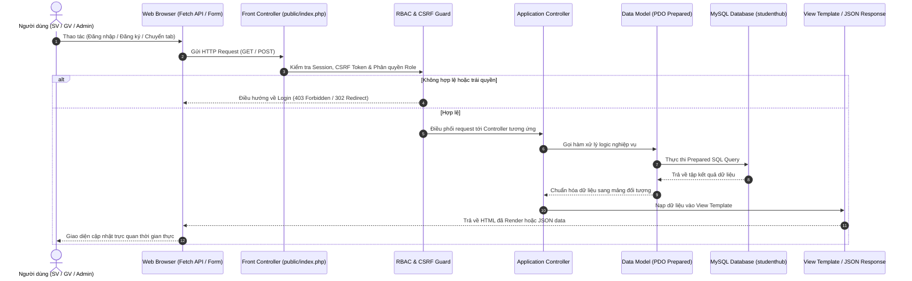
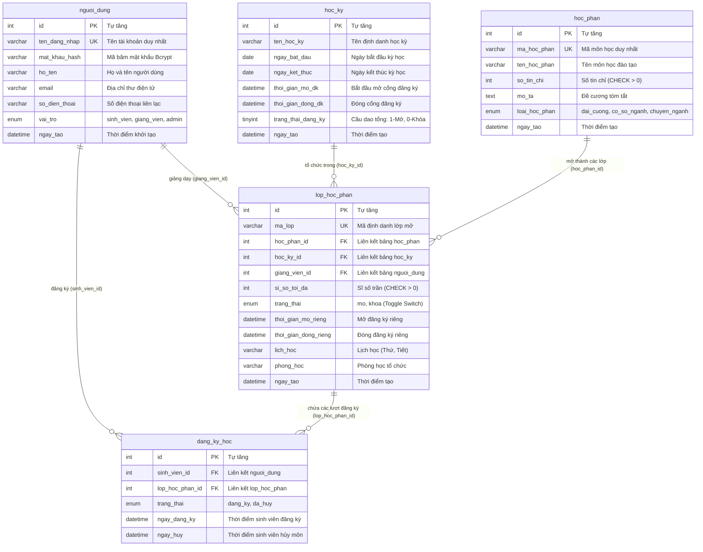

# STUDENTHUB — HỆ THỐNG QUẢN LÝ ĐÀO TẠO & ĐĂNG KÝ HỌC PHẦN TRỰC TUYẾN
> **BÁO CÁO KỸ THUẬT VÀ TÀI LIỆU HỆ THỐNG PHỤC VỤ CHẤM THI & BẢO VỆ ĐỒ ÁN**  
> **Giảng viên hướng dẫn:** ThS. Trần Thị Thu Phương  
> **Học phần:** Lập trình Web — Chủ đề 1  
> **Đơn vị đào tạo:** Khoa Công nghệ Thông tin  
> **Phiên bản hệ thống:** v2.5.0 (Bản hoàn thiện phục vụ nghiệm thu đồ án)

---

## MỤC LỤC TÀI LIỆU
1. [Thông tin chung & Tổng quan hệ thống](#1-thông-tin-chung--tổng-quan-hệ-thống)
2. [Ma trận phân công nhiệm vụ (Responsibility Matrix)](#2-ma-trận-phân-công-nhiệm-vụ-responsibility-matrix)
3. [Kiến trúc hệ thống & Cơ chế điều hướng](#3-kiến-trúc-hệ-thống--cơ-chế-điều-hướng)
4. [Thiết kế Cơ sở dữ liệu & Ràng buộc toàn vẹn](#4-thiết-kế-cơ-sở-dữ-liệu--ràng-buộc-toàn-vẹn)
5. [Cơ chế bảo mật & Kiểm soát dữ liệu](#5-cơ-chế-bảo-mật--kiểm-soát-dữ-liệu)
6. [Hướng dẫn cài đặt & Triển khai trên XAMPP](#6-hướng-dẫn-cài-đặt--triển-khai-trên-xampp)
7. [Bảng tài khoản Demo thử nghiệm](#7-bảng-tài-khoản-demo-thử-nghiệm)
8. [Kịch bản kiểm thử & Nghiệm thu tính năng (Test Cases)](#8-kịch-bản-kiểm-thử--nghiệm-thu-tính-năng)
9. [Đánh giá & Kết luận](#9-đánh-giá--kết-luận)

---

## 1. THÔNG TIN CHUNG & TỔNG QUAN HỆ THỐNG

### 1.1. Bối cảnh & Mục tiêu đề tài
Trong môi trường giáo dục đại học theo học chế tín chỉ, việc đăng ký học phần đòi hỏi tính chính xác, kịp thời và khả năng xử lý đồng thời lớn khi hàng ngàn sinh viên cùng thao tác trong thời gian ngắn. **StudentHub** được nghiên cứu và xây dựng nhằm giải quyết toàn diện bài toán quản lý đào tạo và đăng ký học phần trực tuyến cho trường đại học.

Hệ thống cung cấp giải pháp thống nhất, phân quyền nghiêm ngặt cho 3 nhóm đối tượng:
- **Sinh viên (Student):** Tra cứu chương trình học, xem danh sách lớp học phần theo môn, xem chi tiết lớp học dạng Bento Grid, đăng ký/hủy đăng ký môn học trực tuyến với thuật toán chống trùng lịch và kiểm soát sĩ số trần, theo dõi lịch sử đăng ký và dashboard tiến độ tích lũy.
- **Giảng viên (Lecturer):** Theo dõi danh sách các lớp học phần được phân công giảng dạy, thống kê sĩ số sinh viên, xem danh sách chi tiết sinh viên trong từng lớp và xuất danh sách phục vụ điểm danh, chấm điểm.
- **Quản trị viên (Admin):** Quản lý tài khoản phân quyền 3 cấp độ; quản lý danh mục môn học (`hoc_phan`); quản lý học kỳ và điều khiển "Cầu dao tổng" (`trang_thai_dang_ky`) đóng/mở đợt đăng ký tín chỉ; quản lý lớp học phần với cơ chế Toggle Switch mở/khóa trạng thái từng lớp học.

### 1.2. Ngăn xếp công nghệ (Technology Stack)
- **Backend Core:** PHP 8.x (Thuần hướng đối tượng OOP, không phụ thuộc framework cồng kềnh, tối ưu hiệu năng xử lý).
- **Cơ sở dữ liệu:** MySQL 8.x / MariaDB, kết nối qua **PHP Data Objects (PDO)** với chế độ `PDO::ERRMODE_EXCEPTION` và `PDO::EMULATE_PREPARES => false`.
- **Kiến trúc phần mềm:** Mô hình MVC (Model - View - Controller) mở rộng, áp dụng mẫu thiết kế **Front Controller Pattern** với điểm vào duy nhất (`public/index.php`).
- **Frontend & Giao diện:** HTML5 Semantic, CSS3 hiện đại (CSS Variables, Flexbox, Bento Grid System, Glassmorphism, Responsive Mobile-First), Vanilla JavaScript (ES6+, Fetch API truyền nhận dữ liệu bất đồng bộ không reload trang).
- **Bảo mật ứng dụng:** CSRF Token Guard (`hash_equals`), Session Hijacking Protection, Chuẩn hóa chống XSS (`htmlspecialchars`), Mã hóa mật khẩu một chiều chuẩn công nghiệp `password_hash` (Bcrypt).
- **Thư viện tích hợp:** PHPMailer 6.x (Hỗ trợ xác thực SMTP Gmail gửi email OTP đặt lại mật khẩu).

---

## 2. MA TRẬN PHÂN CÔNG NHIỆM VỤ (RESPONSIBILITY MATRIX)

Bảng ma trận phân công trách nhiệm thể hiện rõ nét vai trò, mã sinh viên và phạm vi tệp mã nguồn (Controller, View, Model, Route, Script) của từng thành viên trong nhóm 5 người:

### 2.1. Bảng tổng hợp phân công trách nhiệm (Responsibility Matrix)

| STT | Họ và tên sinh viên | Mã SV | Vai trò | Module & Trách nhiệm chính | Tệp Controller phụ trách | Tệp View phụ trách | Tệp Model / Route / Script liên quan |
| :---: | :--- | :---: | :---: | :--- | :--- | :--- | :--- |
| **1** | **Phạm Ngọc Anh** *(Nhóm trưởng)* | **224001712** | Trưởng nhóm / DB Architect | • Thiết kế toàn bộ kiến trúc CSDL hệ thống.<br>• Phân hệ Giảng viên (Dashboard, Lớp phụ trách, DSSV).<br>• Phân hệ Quản lý tài khoản Admin (CRUD, Phân quyền). | `app/Controllers/GiangVienController.php`<br>`app/Controllers/AdminTaiKhoanController.php` | `app/Views/giangvien/index.php`<br>`app/Views/giangvien/lop_hoc_phan.php`<br>`app/Views/giangvien/sinh_vien.php`<br>`app/Views/admin/tai_khoan.php`<br>`app/Views/admin/tai_khoan_view.php`<br>`app/Views/layouts/lecturer_sidebar.php` | `app/Models/GiangVienModel.php`<br>`app/Models/AdminTaiKhoanModel.php`<br>`routes/giang_vien.php`<br>`routes/giang_vien_lop_hoc_phan.php`<br>`routes/giang_vien_sinh_vien.php`<br>`database/schema.sql`<br>`database/seed.sql` |
| **2** | **Nguyễn Thị Thu Huyền** | **224001722** | Core Dev / Security & Auth | • Module Đăng nhập đa vai trò, Đổi mật khẩu.<br>• Phân hệ Quên mật khẩu qua Email (PHPMailer SMTP).<br>• Module Danh sách lớp học phần theo môn.<br>• Quản lý Session & Bảo mật phiên làm việc. | `app/Controllers/AuthController.php`<br>`app/Controllers/DanhSachLopHocPhanController.php` | `public/index.php` *(Giao diện xác thực)*<br>`app/Views/auth/quen_mat_khau.php`<br>`app/Views/sinhvien/danh_sach_lop_hoc_phan.php` | `app/Models/DanhSachLopHocPhanModel.php`<br>`app/Core/Auth.php`<br>`routes/danh_sach_lop_hoc_phan.php`<br>`routes/doi_mat_khau.php`<br>`routes/logout.php`<br>`config/mail.php` |
| **3** | **Tạ Như Quỳnh** | **224001744** | Fullstack Dev / UI-UX Lead | • Quản lý Lớp học phần Admin (Toggle Switch mở/khóa).<br>• Dashboard Sinh viên (Tổng quan tín chỉ, thời khóa biểu).<br>• Giao diện Chi tiết lớp học phần Bento Grid (`loai_hoc_phan`). | `app/Controllers/AdminLopHocPhanController.php`<br>`app/Controllers/SinhVienDashboardController.php`<br>`app/Controllers/ClassController.php` | `app/Views/admin/lop_hoc_phan.php`<br>`app/Views/admin/classes/index.php`<br>`app/Views/admin/classes/create.php`<br>`app/Views/admin/classes/edit.php`<br>`app/Views/sinhvien/index.php`<br>`app/Views/classes/detail.php` | `app/Models/AdminLopHocPhanModel.php`<br>`app/Models/SinhVienDashboardModel.php`<br>`app/Models/ClassModel.php`<br>`app/Core/ClassSchedule.php`<br>`routes/admin_lop_hoc_phan.php`<br>`routes/sinh_vien.php`<br>`routes/chi_tiet_lop_hoc_phan.php` |
| **4** | **Nguyễn Thị Kim Anh** | **224001711** | Backend Dev / QA-QC Lead | • Quản lý Học kỳ Admin (Cơ chế Cầu dao tổng Toggle Master).<br>• Module Lịch sử đăng ký học phần Sinh viên.<br>• Đặc tả kỹ thuật kiểm thử, Kế hoạch QA/QC & Test Cases. | `app/Controllers/AdminHocKyController.php`<br>`app/Controllers/LichSuController.php` | `app/Views/admin/hoc_ky.php`<br>`app/Views/lichsu/index.php` | `app/Models/HocKyModel.php`<br>`app/Models/LichSuModel.php`<br>`routes/admin_hoc_ky.php`<br>`routes/lich_su_dang_ky.php`<br>`routes/_require_role.php` |
| **5** | **Lê Khánh Ly** | **224001730** | Logic & Business Dev | • Nghiệp vụ Đăng ký & Hủy đăng ký học phần Sinh viên.<br>• Thuật toán kiểm tra lịch trùng, kiểm soát sĩ số trần.<br>• Phân hệ Quản lý danh mục Học phần Admin (CRUD môn học). | `app/Controllers/DangKyHocController.php`<br>`app/Controllers/HocPhanController.php` | `views/dangky/dangky.php`<br>`app/Views/admin/hoc_phan.php` | `app/Models/DangKyHocModel.php`<br>`app/Models/HocPhan.php`<br>`routes/trang_dang_ky_hoc.php`<br>`routes/dang_ky_hoc.php`<br>`routes/huy_dang_ky_hoc.php`<br>`routes/api_huy_dang_ky.php`<br>`routes/admin_hoc_phan.php` |

---

### 2.2. Đặc tả kỹ thuật chi tiết của từng thành viên

#### I. Phạm Ngọc Anh (Nhóm trưởng) — Mã SV: 224001712
- **Khối Phân hệ Giảng viên:**
  - Xây dựng Controller `app/Controllers/GiangVienController.php` và Model `app/Models/GiangVienModel.php`.
  - Thiết kế màn hình tổng quan giảng viên (`app/Views/giangvien/index.php`) hiển thị số lượng lớp giảng dạy trong kỳ, tổng số sinh viên theo học.
  - Xây dựng màn hình danh sách lớp học phần được phân công (`app/Views/giangvien/lop_hoc_phan.php`) và danh sách chi tiết sinh viên từng lớp (`app/Views/giangvien/sinh_vien.php`).
  - Hỗ trợ xuất và tra cứu dữ liệu danh sách sinh viên theo từng lớp học phần một cách nhanh chóng.
- **Khối Quản lý tài khoản Admin:**
  - Xây dựng Controller `app/Controllers/AdminTaiKhoanController.php` và Model `app/Models/AdminTaiKhoanModel.php`.
  - Thực hiện các thao tác thêm, sửa, xóa, khóa và tìm kiếm tài khoản người dùng (`app/Views/admin/tai_khoan.php`, `app/Views/admin/tai_khoan_view.php`).
  - Thiết lập cơ chế băm mật khẩu `password_hash($matKhau, PASSWORD_DEFAULT)` bảo đảm không lưu mật khẩu dạng bản rõ (plaintext).
- **Kiến trúc Cơ sở dữ liệu:**
  - Soạn thảo và chuẩn hóa 2 tệp kịch bản CSDL cốt lõi: `database/schema.sql` (thiết kế 5 bảng quan hệ chặt chẽ, các ràng buộc toàn vẹn khóa chính, khóa ngoại, `UNIQUE`, `CHECK`) và `database/seed.sql` (tạo 26 tài khoản mẫu cho cả 3 phân hệ, danh mục môn học, học kỳ, lớp mở).

#### II. Nguyễn Thị Thu Huyền — Mã SV: 224001722
- **Module Xác thực & Quản lý Session:**
  - Xây dựng Controller `app/Controllers/AuthController.php` và thư viện lõi `app/Core/Auth.php`.
  - Thiết kế luồng đăng nhập tập trung tại `public/index.php`: xác thực thông tin tài khoản, mật khẩu, đối chiếu vai trò người dùng đã chọn trên giao diện với quyền hạn thực tế trong database nhằm ngăn chặn vượt quyền (Privilege Escalation).
  - Quản lý phiên làm việc bằng PHP Session, cấu hình an toàn cho Session Cookie (`httponly`, `secure`), thiết lập cơ chế xóa sạch phiên và cookie khi đăng xuất (`routes/logout.php`).
- **Phân hệ Quên mật khẩu qua Email (PHPMailer):**
  - Tích hợp thư viện PHPMailer tại `app/Libraries/PHPMailer/` và tệp cấu hình `config/mail.php`.
  - Xây dựng quy trình quên mật khẩu: Sinh token ngẫu nhiên có thời hạn, gửi email thông báo kèm liên kết đặt lại mật khẩu an toàn đến hòm thư sinh viên/giảng viên (`app/Views/auth/quen_mat_khau.php`).
- **Module Danh sách lớp học phần theo môn học:**
  - Xây dựng Controller `app/Controllers/DanhSachLopHocPhanController.php` và Model `app/Models/DanhSachLopHocPhanModel.php`.
  - Hiển thị danh mục lớp học phần đang mở theo từng học phần cụ thể cho sinh viên (`app/Views/sinhvien/danh_sach_lop_hoc_phan.php`), kết nối dữ liệu sĩ số thực tế và lịch học.

#### III. Tạ Như Quỳnh — Mã SV: 224001744
- **Quản lý Lớp học phần Admin (Toggle Switch mở/khóa):**
  - Xây dựng Controller `app/Controllers/AdminLopHocPhanController.php`, Model `app/Models/AdminLopHocPhanModel.php` và `app/Models/ClassModel.php`.
  - Cung cấp giao diện quản lý lớp mở đa năng (`app/Views/admin/lop_hoc_phan.php` và thư mục `app/Views/admin/classes/`): tạo mới lớp học phần, chỉnh sửa giảng viên, phòng học, sĩ số tối đa.
  - **Kỹ thuật Toggle Switch:** Xây dựng phương thức `toggleStatus()` trong Controller cho phép Quản trị viên kích hoạt hoặc đóng tức thì từng lớp học phần (`trang_thai = 'mo'` sang `'khoa'` và ngược lại) mà không cần vào trang chỉnh sửa chi tiết.
- **Dashboard Sinh viên:**
  - Xây dựng Controller `app/Controllers/SinhVienDashboardController.php`, Model `app/Models/SinhVienDashboardModel.php` và View `app/Views/sinhvien/index.php`.
  - Tổng hợp dữ liệu thời gian thực: số tín chỉ đã đăng ký trong kỳ, tín chỉ tích lũy, các thông báo học vụ quan trọng và widget thời khóa biểu tuần trực quan.
- **Chi tiết lớp học phần Bento Grid (`loai_hoc_phan`):**
  - Xây dựng View `app/Views/classes/detail.php` với cấu trúc **Bento Grid** hiện đại.
  - Phân tích và hiển thị trực quan thông tin phân loại môn học (`loai_hoc_phan`: Đại cương, Cơ sở ngành, Chuyên ngành).
  - Tích hợp thanh tiến độ sĩ số (Progress bar) phản ánh trực quan tỷ lệ sinh viên đã đăng ký so với sĩ số tối đa; xử lý các thông số thời gian mở/đóng đăng ký riêng biệt của lớp.

#### IV. Nguyễn Thị Kim Anh — Mã SV: 224001711
- **Quản lý Học kỳ Admin (Cơ chế Cầu dao tổng Toggle Master):**
  - Xây dựng Controller `app/Controllers/AdminHocKyController.php` và Model `app/Models/HocKyModel.php`.
  - Thiết kế giao diện quản trị kỳ học (`app/Views/admin/hoc_ky.php`), hỗ trợ thêm mới, cập nhật thời gian mở/đóng cổng đăng ký tín chỉ và ngày bắt đầu/kết thúc học kỳ.
  - **Thuật toán Cầu dao tổng (Master Switch):** Xây dựng tính năng kích hoạt `trang_thai_dang_ky` (0 hoặc 1) tại bảng `hoc_ky`. Khi cầu dao này đóng, toàn bộ sinh viên trong toàn trường lập tức bị chặn không thể đăng ký hay hủy lớp học phần của học kỳ đó, kể cả khi lớp học phần riêng lẻ đang ở trạng thái `'mo'`.
  - Xây dựng thuật toán kiểm tra ràng buộc logic thời gian: chặn tạo học kỳ kết thúc trong quá khứ, yêu cầu thời gian đóng cổng đăng ký phải trước ngày khai giảng học kỳ tối thiểu 7 ngày.
- **Module Lịch sử đăng ký Sinh viên:**
  - Xây dựng Controller `app/Controllers/LichSuController.php` và Model `app/Models/LichSuModel.php`.
  - Thiết kế giao diện tra cứu lịch sử (`app/Views/lichsu/index.php`): sinh viên dễ dàng tra cứu toàn bộ các lượt đăng ký, các lượt đã hủy môn, ngày giờ thao tác chính xác và tổng số tín chỉ đăng ký thành công qua từng kỳ học.
- **Đặc tả kiểm thử & Đảm bảo chất lượng (QA/QC):**
  - Xây dựng ma trận kiểm thử toàn diện gồm hơn 15 kịch bản (Test Cases) kiểm tra từ tính toàn vẹn dữ liệu, kiểm thử ràng buộc giao diện đến các ca kiểm thử bảo mật nâng cao.

#### V. Lê Khánh Ly — Mã SV: 224001730
- **Nghiệp vụ Đăng ký & Hủy đăng ký học phần:**
  - Xây dựng Controller `app/Controllers/DangKyHocController.php` và Model `app/Models/DangKyHocModel.php`.
  - Thiết kế giao diện đăng ký tín chỉ trực tuyến tương tác cao (`views/dangky/dangky.php`).
  - Xử lý các route nghiệp vụ: `routes/trang_dang_ky_hoc.php`, `routes/dang_ky_hoc.php`, `routes/huy_dang_ky_hoc.php`, `routes/api_huy_dang_ky.php`.
  - **Thuật toán đăng ký an toàn & kiểm tra xung đột:**
    1. Kiểm tra "Cầu dao tổng" của học kỳ (`trang_thai_dang_ky = 1`) và thời hạn đăng ký (`thoi_gian_mo_dk <= NOW() <= thoi_gian_dong_dk`).
    2. Kiểm tra trạng thái riêng của lớp học phần (`trang_thai = 'mo'`).
    3. Kiểm tra sĩ số trần: Khóa thao tác ngay khi `si_so_hien_tai >= si_so_toi_da`.
    4. Kiểm tra chống đăng ký trùng lớp hoặc trùng môn học trong cùng một học kỳ.
    5. Kiểm tra xung đột lịch học: Sử dụng thuật toán `phanTichLichHoc()` tách thứ và tiết học để so sánh với các lớp đã đăng ký trước đó, chặn sinh viên đăng ký 2 lớp học có khung giờ trùng nhau.
- **Quản lý danh mục Học phần Admin:**
  - Xây dựng Controller `app/Controllers/HocPhanController.php` và Model `app/Models/HocPhan.php`.
  - Thiết kế giao diện quản lý môn học (`app/Views/admin/hoc_phan.php`): Thực hiện CRUD môn học, quản lý mã học phần, tên học phần, số tín chỉ (ràng buộc `so_tin_chi > 0`), phân loại khối kiến thức (`dai_cuong`, `co_so_nganh`, `chuyen_nganh`).

---

## 3. KIẾN TRÚC HỆ THỐNG & CƠ CHẾ ĐIỀU HƯỚNG

### 3.1. Điểm vào ứng dụng duy nhất (Front Controller Pattern)
Hệ thống StudentHub tuân thủ nghiêm ngặt nguyên lý thiết kế hiện đại với **Single Web Entry Point**:
- Tệp `public/index.php` là điểm tiếp nhận duy nhất cho toàn bộ các yêu cầu HTTP từ trình duyệt người dùng.
- Tệp `public/.htaccess` sử dụng engine `mod_rewrite` của Apache để chặn toàn bộ các nỗ lực truy cập trực tiếp vào các tệp PHP nội bộ, đồng thời điều hướng mọi request hợp lệ qua Front Controller thông qua tham số `?route=...`.
- Cơ chế bảo vệ vai trò tập trung: Tệp `routes/_require_role.php` và các Controller đều kiểm tra tính hợp lệ của `$_SESSION['role']` trước khi cho phép nạp tài nguyên giao diện, đảm bảo tài khoản sinh viên không thể xem trang của giảng viên hay can thiệp vào khu vực quản trị.

### 3.2. Cấu trúc thư mục dự án
```text
studenthub/
├── app/
│   ├── Controllers/             # Chứa 12 Controller điều phối nghiệp vụ hệ thống
│   │   ├── AdminDashboardController.php
│   │   ├── AdminHocKyController.php       # Quản lý học kỳ & Cầu dao tổng (Kim Anh)
│   │   ├── AdminLopHocPhanController.php  # Quản lý lớp mở & Toggle Status (Như Quỳnh)
│   │   ├── AdminTaiKhoanController.php    # Quản lý tài khoản Admin (Ngọc Anh)
│   │   ├── AuthController.php             # Xác thực, Đổi & Quên mật khẩu (Thu Huyền)
│   │   ├── ClassController.php
│   │   ├── DangKyHocController.php        # Đăng ký & Hủy học phần (Khánh Ly)
│   │   ├── DanhSachLopHocPhanController.php # Lớp theo môn học (Thu Huyền)
│   │   ├── GiangVienController.php        # Phân hệ Giảng viên (Ngọc Anh)
│   │   ├── HocPhanController.php          # Quản lý danh mục môn học (Khánh Ly)
│   │   ├── LichSuController.php           # Lịch sử đăng ký tín chỉ (Kim Anh)
│   │   ├── SinhVienController.php
│   │   └── SinhVienDashboardController.php# Dashboard sinh viên (Như Quỳnh)
│   ├── Core/                    # Các lớp tiện ích bảo mật và xử lý lịch học
│   │   ├── Auth.php
│   │   └── ClassSchedule.php
│   ├── Libraries/               # Thư viện bên thứ ba (PHPMailer 6.x)
│   │   └── PHPMailer/
│   ├── Models/                  # Chứa các Model tương tác CSDL qua PDO
│   │   ├── AdminDashboardModel.php
│   │   ├── AdminLopHocPhanModel.php
│   │   ├── AdminTaiKhoanModel.php
│   │   ├── ClassModel.php
│   │   ├── DangKyHocModel.php
│   │   ├── DanhSachLopHocPhanModel.php
│   │   ├── GiangVienModel.php
│   │   ├── HocKyModel.php
│   │   ├── HocPhan.php
│   │   ├── LichSuModel.php
│   │   ├── LopHocPhanModel.php
│   │   └── SinhVienDashboardModel.php
│   └── Views/                   # Chứa giao diện phân tầng theo từng phân hệ
│       ├── admin/               # Giao diện Quản trị viên (hoc_ky, hoc_phan, lop_hoc_phan, tai_khoan)
│       ├── auth/                # Giao diện Quên mật khẩu
│       ├── classes/             # Giao diện Chi tiết lớp học phần Bento Grid (detail.php)
│       ├── giangvien/           # Giao diện Giảng viên (lop_hoc_phan, sinh_vien)
│       ├── layouts/             # Giao diện khung dùng chung (header, footer, sidebars)
│       ├── lichsu/              # Giao diện Lịch sử đăng ký sinh viên
│       └── sinhvien/            # Giao diện Dashboard và Danh sách lớp
├── assets/                      # Tài nguyên tĩnh (CSS, JavaScript, Icons, Images)
├── config/                      # Cấu hình CSDL và máy chủ SMTP
│   ├── database.php             # Kết nối PDO CSDL studenthub
│   └── mail.php                 # Cấu hình tài khoản gửi mail Gmail SMTP
├── database/                    # Kịch bản CSDL
│   ├── schema.sql               # Định nghĩa cấu trúc 5 bảng và khóa ngoại
│   └── seed.sql                 # Dữ liệu mẫu hoàn chỉnh 26 tài khoản 3 vai trò
├── docs/                        # Tài liệu đặc tả và ảnh chụp giao diện
│   └── images/
├── public/                      # Thư mục Web Root công khai
│   ├── .htaccess                # Cấu hình rewrite rules
│   └── index.php                # Điểm vào ứng dụng duy nhất & Form đăng nhập
├── routes/                      # Các handlers định tuyến nội bộ được bảo vệ
│   ├── _require_role.php        # Middleware kiểm tra vai trò người dùng
│   ├── admin_hoc_ky.php
│   ├── admin_hoc_phan.php
│   ├── admin_lop_hoc_phan.php
│   ├── dang_ky_hoc.php
│   ├── giang_vien.php
│   └── ...
├── views/
│   └── dangky/dangky.php        # View giao diện Đăng ký học phần sinh viên
└── README.md                    # Tài liệu kỹ thuật chính thức của đồ án
```

### 3.3. Sơ đồ luồng xử lý Request (Architecture Workflow)



---

## 4. THIẾT KẾ CƠ SỞ DỮ LIỆU & RÀNG BUỘC TOÀN VẸN

### 4.1. Thông số CSDL
- **Tên cơ sở dữ liệu:** `studenthub`
- **Bộ mã ký tự (Charset / Collation):** `utf8mb4` / `utf8mb4_unicode_ci` (Hỗ trợ tiếng Việt có dấu và ký tự mở rộng).
- **Engine lưu trữ:** `InnoDB` (Hỗ trợ cơ chế Transaction ACID và ràng buộc khóa ngoại Foreign Keys).

### 4.2. Sơ đồ thực thể quan hệ (ERD - Entity Relationship Diagram)



### 4.3. Đặc tả chi tiết 5 bảng dữ liệu cốt lõi

#### 1. Bảng `nguoi_dung` (Tài khoản người dùng & Phân quyền)
Lưu trữ thông tin xác thực của cả 3 nhóm người dùng: Sinh viên, Giảng viên và Quản trị viên.
- `id` (INT, Auto Increment, Primary Key): Khóa chính định danh người dùng.
- `ten_dang_nhap` (VARCHAR(50), NOT NULL, UNIQUE): Tên tài khoản (Mã SV, Mã GV hoặc admin).
- `mat_khau_hash` (VARCHAR(255), NOT NULL): Mật khẩu đã được mã hóa một chiều qua thuật toán Bcrypt.
- `ho_ten` (VARCHAR(100), NOT NULL): Họ và tên đầy đủ của người dùng.
- `email` (VARCHAR(100), NULL): Email nhận thông báo học vụ và OTP đặt lại mật khẩu.
- `so_dien_thoai` (VARCHAR(20), NULL): Số điện thoại liên lạc.
- `vai_tro` (ENUM('sinh_vien', 'giang_vien', 'admin'), NOT NULL): Phân quyền tài khoản trong hệ thống.
- `ngay_tao` (DATETIME, DEFAULT CURRENT_TIMESTAMP): Thời gian khởi tạo tài khoản.

#### 2. Bảng `hoc_ky` (Khung thời gian đào tạo & Cầu dao tổng)
Lưu trữ các học kỳ trong năm học và kiểm soát đợt đăng ký tín chỉ toàn trường.
- `id` (INT, Auto Increment, Primary Key): Khóa chính định danh học kỳ.
- `ten_hoc_ky` (VARCHAR(100), NOT NULL): Tên học kỳ (VD: "Học kỳ 1 năm học 2026-2027").
- `ngay_bat_dau` (DATE, NOT NULL): Ngày chính thức bắt đầu học kỳ.
- `ngay_ket_thuc` (DATE, NOT NULL): Ngày kết thúc học kỳ.
- `thoi_gian_mo_dk` (DATETIME, NOT NULL): Thời điểm bắt đầu mở cổng đăng ký tín chỉ toàn trường.
- `thoi_gian_dong_dk` (DATETIME, NOT NULL): Thời điểm chính thức đóng cổng đăng ký tín chỉ.
- `trang_thai_dang_ky` (TINYINT(1), NOT NULL, DEFAULT 1): **Cầu dao tổng** mở (`1`) hoặc đóng (`0`) cổng đăng ký cho toàn bộ các lớp thuộc học kỳ.

#### 3. Bảng `hoc_phan` (Danh mục môn học đào tạo)
Lưu trữ chương trình môn học đào tạo của nhà trường.
- `id` (INT, Auto Increment, Primary Key): Khóa chính môn học.
- `ma_hoc_phan` (VARCHAR(20), NOT NULL, UNIQUE): Mã định danh môn học (VD: `INT101`, `WEB102`).
- `ten_hoc_phan` (VARCHAR(150), NOT NULL): Tên gọi môn học.
- `so_tin_chi` (INT, NOT NULL, CHECK > 0): Số tín chỉ đào tạo của môn học.
- `mo_ta` (TEXT, NULL): Mô tả tóm tắt nội dung đề cương môn học.
- `loai_hoc_phan` (ENUM('dai_cuong', 'co_so_nganh', 'chuyen_nganh'), DEFAULT 'dai_cuong'): Phân loại khối kiến thức để render huy hiệu tương ứng trên Bento Grid.

#### 4. Bảng `lop_hoc_phan` (Lớp học phần mở thực tế theo kỳ)
Đóng vai trò trung tâm liên kết giữa môn học, học kỳ, giảng viên phụ trách và lịch trình học tập.
- `id` (INT, Auto Increment, Primary Key): Khóa chính định danh lớp mở.
- `ma_lop` (VARCHAR(50), NOT NULL, UNIQUE): Mã định danh lớp học phần (VD: `WEB102-01`).
- `hoc_phan_id` (INT, Foreign Key): Tham chiếu tới `hoc_phan(id)`.
- `hoc_ky_id` (INT, Foreign Key): Tham chiếu tới `hoc_ky(id)`.
- `giang_vien_id` (INT, Foreign Key, NULL): Tham chiếu tới `nguoi_dung(id)` với vai trò giảng viên phụ trách.
- `si_so_toi_da` (INT, NOT NULL, DEFAULT 40, CHECK > 0): Sĩ số giới hạn tối đa của lớp.
- `trang_thai` (ENUM('mo', 'khoa'), DEFAULT 'mo'): Trạng thái cho phép đăng ký riêng biệt của lớp (Toggle Switch).
- `thoi_gian_mo_rieng` / `thoi_gian_dong_rieng` (DATETIME, NULL): Khung thời gian mở đăng ký đặc thù cho lớp nếu khác với học kỳ chung.
- `lich_hoc` (VARCHAR(100), NULL): Lịch học cố định (VD: "Thứ 2, Thứ 4, tiết 1-3").
- `phong_hoc` (VARCHAR(100), NULL): Địa điểm phòng học (VD: "Phòng A2-301").

#### 5. Bảng `dang_ky_hoc` (Ghi nhận đăng ký tín chỉ của sinh viên)
Lưu vết chi tiết hoạt động đăng ký hoặc hủy môn học của sinh viên.
- `id` (INT, Auto Increment, Primary Key): Khóa chính bản ghi đăng ký.
- `sinh_vien_id` (INT, Foreign Key): Tham chiếu tới tài khoản sinh viên `nguoi_dung(id)`.
- `lop_hoc_phan_id` (INT, Foreign Key): Tham chiếu tới `lop_hoc_phan(id)`.
- `trang_thai` (ENUM('dang_ky', 'da_huy'), DEFAULT 'dang_ky'): Trạng thái hiện thời của môn học.
- `ngay_dang_ky` (DATETIME, DEFAULT CURRENT_TIMESTAMP): Thời điểm thực hiện đăng ký thành công.
- `ngay_huy` (DATETIME, NULL): Thời điểm sinh viên thực hiện hủy học phần.
- **Ràng buộc toàn vẹn duy nhất (UNIQUE):** `uc_sinh_vien_lop UNIQUE (sinh_vien_id, lop_hoc_phan_id)` bảo đảm tuyệt đối một sinh viên không thể đăng ký trùng 2 bản ghi cho cùng một lớp học phần.

### 4.4. Hệ thống Chỉ mục tối ưu hóa hiệu năng (Performance Indexes)
Để đảm bảo tốc độ phản hồi tính toán sĩ số và tra cứu tức thì dưới tải lớn, các chỉ mục (Indexes) B-Tree sau đã được thiết lập:
- `idx_nguoi_dung_vai_tro`: Tối ưu hóa truy vấn lọc danh sách tài khoản theo vai trò.
- `idx_lop_hoc_phan_ky`: Tối ưu truy vấn danh sách lớp mở theo học kỳ và môn học.
- `idx_lop_giang_vien`: Tối ưu truy vấn phân hệ Giảng viên lấy danh sách lớp được giao.
- `idx_dkh_trang_thai`: Tối ưu việc tính toán sĩ số thời gian thực (`COUNT(*) WHERE trang_thai = 'dang_ky'`).
- `idx_dkh_sinh_vien`: Tối ưu màn hình tra cứu Lịch sử đăng ký và Dashboard tích lũy tín chỉ của sinh viên.

---

## 5. CƠ CHẾ BẢO MẬT & KIỂM SOÁT DỮ LIỆU

Hệ thống StudentHub tuân thủ tiêu chuẩn an toàn thông tin OWASP Top 10 đối với ứng dụng web giáo dục:

1. **Phòng chống SQL Injection:**
   - Tuyệt đối không nối chuỗi biến trực tiếp vào câu lệnh SQL.
   - 100% các thao tác đọc/ghi CSDL đều sử dụng cơ chế **PDO Prepared Statements** với tham số ràng buộc (`$stmt->prepare()` và `$stmt->execute([':param' => $value])`).

2. **Phòng chống Cross-Site Scripting (XSS):**
   - Mọi dữ liệu do người dùng nhập hoặc lấy từ database trước khi hiển thị ra cây DOM đều được lọc và chuẩn hóa bằng hàm:
     ```php
     htmlspecialchars((string)$data, ENT_QUOTES, 'UTF-8');
     ```
   - Ngăn chặn triệt để nguy cơ tiêm mã script độc hại vào trình duyệt người dùng khác.

3. **Phòng chống Cross-Site Request Forgery (CSRF):**
   - Áp dụng token CSRF bảo vệ toàn bộ các thao tác nhạy cảm (Đăng ký môn, Hủy môn, Đổi mật khẩu, Thêm/Sửa/Xóa lớp học phần, Bật/Tắt Toggle Switch).
   - Token ngẫu nhiên độ an toàn cao được khởi tạo thông qua `bin2hex(random_bytes(32))` lưu trong `$_SESSION['csrf_token']` và kiểm tra đối chiếu bằng hàm so sánh an toàn thời gian cố định `hash_equals()`.

4. **Bảo vệ Phiên làm việc (Session Security):**
   - Hủy toàn bộ biến session và xóa sạch Session Cookie ở trình duyệt khi người dùng bấm Đăng xuất.
   - Khởi tạo cookie với cờ `HttpOnly` (ngăn JavaScript đọc Session ID) và `SameSite=Lax` (giảm thiểu tấn công CSRF qua liên kết ngoài).

5. **Mã hóa Mật khẩu Chuẩn công nghiệp:**
   - Sử dụng hàm chuẩn của PHP: `password_hash($matKhau, PASSWORD_DEFAULT)` sinh chuỗi mã hóa Bcrypt tự động kèm Salt ngẫu nhiên.
   - Xác thực đăng nhập bằng `password_verify($matKhauNhap, $matKhauHash)` an toàn, loại bỏ nguy cơ rò rỉ dữ liệu mật khẩu người dùng.

---

## 6. HƯỚNG DẪN CÀI ĐẶT & TRIỂN KHAI TRÊN XAMPP

### 6.1. Yêu cầu môi trường vận hành
- **Web Server:** Apache 2.4+ (Kèm module `mod_rewrite` đã được kích hoạt).
- **Ngôn ngữ:** PHP 8.0 trở lên (khuyến nghị PHP 8.1 hoặc PHP 8.2). Yêu cầu kích hoạt các extension: `pdo_mysql`, `openssl`, `mbstring`.
- **Cơ sở dữ liệu:** MySQL 8.0+ hoặc MariaDB 10.4+.
- **Bộ phần mềm trọn gói đề xuất:** **XAMPP for Windows** (Phiên bản hỗ trợ PHP 8.x).

---

### 6.2. Các bước triển khai chi tiết trên máy cục bộ

#### Bước 1: Sao chép mã nguồn vào thư mục XAMPP
- Sao chép toàn bộ thư mục dự án `studenthub` vào đúng thư mục gốc web của XAMPP:
  ```text
  C:\xampp\htdocs\studenthub
  ```

#### Bước 2: Khởi động các dịch vụ máy chủ
- Mở **XAMPP Control Panel**.
- Nhấn **Start** tại dịch vụ **Apache**.
- Nhấn **Start** tại dịch vụ **MySQL**.
- Đảm bảo cả hai dịch vụ đều chuyển sang màu xanh lá cây và hiển thị cổng hoạt động (Port 80/443 cho Apache, Port 3306 cho MySQL).

#### Bước 3: Tạo mới và Import Cơ sở dữ liệu `studenthub`
1. Mở trình duyệt web và truy cập vào công cụ quản trị:
   ```text
   http://localhost/phpmyadmin/
   ```
2. Nhấn vào mục **Databases (Cơ sở dữ liệu)** trên thanh menu:
   - Nhập tên cơ sở dữ liệu: `studenthub`
   - Bảng mã (Collation): chọn `utf8mb4_unicode_ci`
   - Nhấn nút **Create (Tạo)**.
3. Chọn cơ sở dữ liệu `studenthub` vừa tạo ở danh sách cột bên trái.
4. Chuyển sang tab **Import (Nhập)**:
   - Nhấn **Choose File (Chọn tệp)** và duyệt đến tệp:
     ```text
     C:\xampp\htdocs\studenthub\database\schema.sql
     ```
   - Cuộn xuống dưới cùng và nhấn **Import (Thực hiện)**. Chờ màn hình thông báo hoàn thành màu xanh.
5. Tiếp tục chọn tab **Import (Nhập)** lần thứ 2:
   - Nhấn **Choose File (Chọn tệp)** và duyệt đến tệp chứa dữ liệu mẫu:
     ```text
     C:\xampp\htdocs\studenthub\database\seed.sql
     ```
   - Nhấn **Import (Thực hiện)**. Sau khi hoàn tất, CSDL `studenthub` đã sẵn sàng với 5 bảng dữ liệu và 26 tài khoản mẫu.

#### Bước 4: Kiểm tra tệp cấu hình kết nối CSDL
- Tệp `config/database.php` đã được nhóm lập trình tối ưu hóa với cơ chế mảng mật khẩu dự phòng tự động nhận diện cả mật khẩu rỗng `""` và các mật khẩu phổ biến của máy chủ trường học:
  ```php
  <?php
  $passwords = ['Quynh@24012006', '123456', '03112006', ''];
  $pdo = null;

  foreach ($passwords as $pwd) {
      try {
          $pdo = new PDO("mysql:host=localhost;dbname=studenthub;charset=utf8mb4", "root", $pwd, [
              PDO::ATTR_ERRMODE => PDO::ERRMODE_EXCEPTION,
              PDO::ATTR_DEFAULT_FETCH_MODE => PDO::FETCH_ASSOC,
              PDO::ATTR_EMULATE_PREPARES => false,
          ]);
          break;
      } catch (PDOException $e) {
          continue;
      }
  }

  if (!$pdo) {
      die("Không thể kết nối CSDL. Vui lòng kiểm tra cấu hình MySQL.");
  }

  $conn = $pdo;
  ```
- Nếu máy tính của Thầy/Cô sử dụng tài khoản MySQL `root` với mật khẩu riêng, vui lòng bổ sung mật khẩu đó vào mảng `$passwords` trong tệp trên.

#### Bước 5: Cấu hình gửi Mail khôi phục mật khẩu (Tùy chọn)
- Nếu cần chạy thử tính năng Quên mật khẩu gửi mail OTP thực tế, hệ thống đã cấu hình sẵn tài khoản Gmail SMTP tại `config/mail.php`.
- Đảm bảo máy tính chạy kiểm thử có kết nối mạng Internet để PHPMailer gửi mail qua cổng 587 (TLS).

#### Bước 6: Khởi chạy và trải nghiệm ứng dụng
- Mở trình duyệt web (Google Chrome, Microsoft Edge, Firefox) và truy cập vào đường dẫn:
  ```text
  http://localhost/studenthub/public/index.php
  ```
- Giao diện đăng nhập hiện đại với phong cách Split-Screen và bộ chọn vai trò Bento Grid sẽ xuất hiện sẵn sàng cho việc kiểm thử.

---

## 7. BẢNG TÀI KHOẢN DEMO THỬ NGHIỆM

Hệ thống đã nạp sẵn 26 tài khoản thử nghiệm đại diện cho cả 3 phân hệ. Tất cả tài khoản demo đều có mật khẩu mặc định chung là: `123456`.

### 7.1. Phân hệ Quản trị viên (Admin)
| Tên đăng nhập | Mật khẩu mặc định | Họ và tên | Email | Vai trò phân quyền | Ghi chú kiểm thử |
| :--- | :---: | :--- | :--- | :---: | :--- |
| `admin` | `123456` | Quản trị viên Hệ thống | `admin@studenthub.edu.vn` | **admin** | Toàn quyền quản lý: Cầu dao học kỳ, Toggle lớp học phần, Quản lý tài khoản & Môn học |

---

### 7.2. Phân hệ Giảng viên (Lecturer)
| Tên đăng nhập | Mật khẩu mặc định | Học hàm / Họ và tên | Email | Vai trò phân quyền | Lớp phân công tiêu biểu |
| :--- | :---: | :--- | :--- | :---: | :--- |
| `GV001` | `123456` | ThS Trần Bình Trọng | `trong.tb@studenthub.edu.vn` | **giang_vien** | `WEB102-01` (Lập trình Web), `MAT101-01` (Toán cao cấp) |
| `GV002` | `123456` | TS Lê Phương Hoa | `hoa.lp@studenthub.edu.vn` | **giang_vien** | `INT204-01` (Cơ sở dữ liệu) |
| `GV003` | `123456` | PGS.TS Nguyễn Văn An | `an.nv@studenthub.edu.vn` | **giang_vien** | `MAT205-01` (Xác suất thống kê) |
| `GV004` | `123456` | ThS Hoàng Bích Ngọc | `ngoc.hb@studenthub.edu.vn` | **giang_vien** | `ENG101-01` (Tiếng Anh chuyên ngành) |
| `GV005` | `123456` | TS Vũ Đình Đạt | `dat.vd@studenthub.edu.vn` | **giang_vien** | `PRG201-01` (Cấu trúc dữ liệu & Giải thuật) |

---

### 7.3. Phân hệ Sinh viên (Student)
| Tên đăng nhập | Mật khẩu mặc định | Họ và tên sinh viên | Khóa học | Email | Vai trò | Trạng thái đăng ký mẫu |
| :--- | :---: | :--- | :---: | :--- | :---: | :--- |
| `SV001` | `123456` | Nguyễn Thu Trang | K24 | `trang.nt@studenthub.edu.vn` | **sinh_vien** | Đã đăng ký môn học mẫu, có dữ liệu lịch sử |
| `SV002` | `123456` | Vũ Quốc Bảo | K24 | `bao.vq@studenthub.edu.vn` | **sinh_vien** | Đã đăng ký môn học mẫu |
| `SV003` | `123456` | Lê Hoàng Nam | K23 | `nam.lh@studenthub.edu.vn` | **sinh_vien** | Sinh viên năm 3 |
| `SV004` | `123456` | Phạm Mai Phương | K25 | `phuong.pm@studenthub.edu.vn` | **sinh_vien** | Sinh viên năm nhất |
| `SV005` | `123456` | Đỗ Minh Quân | K24 | `quan.dm@studenthub.edu.vn` | **sinh_vien** | Tài khoản trắng chưa đăng ký môn, thuận tiện test đăng ký mới |
| `SV006` - `SV020`| `123456` | Danh sách 15 SV khác | K23-K25 | `*@studenthub.edu.vn` | **sinh_vien** | Tham gia phân bổ sĩ số cho các lớp học phần |

---

## 8. KỊCH BẢN KIỂM THỬ & NGHIỆM THU TÍNH NĂNG

Bộ kiểm thử được xây dựng nghiêm ngặt nhằm đánh giá toàn diện các luồng nghiệp vụ của hệ thống:

| Mã TC | Phân hệ / Tính năng | Kịch bản kiểm thử (Test Scenario) | Các bước thực hiện & Dữ liệu kiểm tra | Kết quả mong đợi | Trạng thái nghiệm thu |
| :---: | :--- | :--- | :--- | :--- | :---: |
| **TC01** | Xác thực hệ thống | Bỏ trống thông tin đăng nhập | Bấm nút "Đăng nhập" khi chưa nhập Username hoặc Password. | Báo lỗi viền đỏ trực tiếp tại ô dữ liệu, thông báo yêu cầu nhập đầy đủ thông tin. | **PASSED** |
| **TC02** | Xác thực hệ thống | Nhập sai tài khoản hoặc mật khẩu | Nhập `SV001` / Mật khẩu: `sai_mat_khau`. | Báo lỗi: "Tên đăng nhập hoặc mật khẩu không chính xác." Không tạo session. | **PASSED** |
| **TC03** | Xác thực hệ thống | Chọn sai vai trò người dùng | Chọn tab "Giảng viên" nhưng nhập tài khoản sinh viên `SV001` / `123456`. | Hệ thống từ chối đăng nhập, cảnh báo không khớp vai trò được phân quyền. | **PASSED** |
| **TC04** | Xác thực hệ thống | Đăng nhập thành công với vai trò Admin | Chọn tab "Quản trị", nhập `admin` / `123456`. | Đăng nhập thành công, điều hướng chuẩn xác vào Dashboard Quản trị. | **PASSED** |
| **TC05** | Phân quyền truy cập | Cố tình truy cập trái phép URL Admin | Dùng tài khoản `SV001` đã đăng nhập rồi gõ URL: `?route=admin_lop_hoc_phan.php`. | Chặn truy cập (Mã lỗi 403 Forbidden hoặc điều hướng về trang Sinh viên). | **PASSED** |
| **TC06** | Quản trị học kỳ | "Cầu dao tổng" kiểm soát đăng ký | Admin gạt switch tắt `trang_thai_dang_ky` của học kỳ hiện tại sang `0`. | Toàn bộ sinh viên vào trang Đăng ký đều bị khóa nút, hiển thị thông báo cổng đăng ký đang đóng. | **PASSED** |
| **TC07** | Quản lý lớp mở | Toggle Switch mở/khóa từng lớp | Admin bật/tắt Toggle trạng thái của lớp `WEB102-01` từ `mo` sang `khoa`. | Trạng thái cập nhật tức thì; sinh viên thấy lớp chuyển sang trạng thái "Đã khóa" và không thể ấn đăng ký. | **PASSED** |
| **TC08** | Đăng ký học phần | Đăng ký môn học hợp lệ | Sinh viên `SV005` chọn môn chưa đăng ký, bấm nút "Đăng ký học". | Đăng ký thành công, sĩ số lớp tăng thêm 1, môn xuất hiện ngay trong danh sách đã chọn. | **PASSED** |
| **TC09** | Đăng ký học phần | Chặn đăng ký khi lớp hết chỗ | Sinh viên cố đăng ký vào lớp có `si_so_hien_tai >= si_so_toi_da`. | Báo lỗi: "Lớp học phần đã đủ sĩ số tối đa, không thể tiếp nhận thêm sinh viên." | **PASSED** |
| **TC10** | Đăng ký học phần | Chặn đăng ký trùng lịch học | Sinh viên đăng ký lớp thứ 2 có khung giờ trùng với lớp thứ 1 đã đăng ký. | Thuật toán `phanTichLichHoc()` phát hiện xung đột thời khóa biểu và cảnh báo chi tiết thứ/tiết bị trùng. | **PASSED** |
| **TC11** | Đăng ký học phần | Chặn đăng ký trùng môn | Sinh viên đăng ký lớp thứ 2 của môn học mà sinh viên đã đăng ký một lớp khác. | Hệ thống chặn thao tác, thông báo sinh viên đã đăng ký môn học này trong kỳ. | **PASSED** |
| **TC12** | Hủy học phần | Sinh viên tự hủy môn học trong hạn | Sinh viên bấm nút "Hủy đăng ký" trên lớp đã chọn tại trang đăng ký. | Cập nhật trạng thái bản ghi thành `da_huy`, sĩ số lớp giảm 1, trả lại chỗ trống cho sinh viên khác. | **PASSED** |
| **TC13** | Lịch sử đăng ký | Theo dõi tiến trình đăng ký | Sinh viên truy cập menu "Lịch sử đăng ký". | Hiển thị đầy đủ danh sách các lượt đăng ký và lượt hủy kèm mốc thời gian thao tác chính xác. | **PASSED** |
| **TC14** | Phân hệ Giảng viên | Thống kê danh sách sinh viên lớp | Giảng viên `GV001` đăng nhập, chọn lớp `WEB102-01`. | Hiển thị chuẩn xác danh sách sinh viên thực tế đã đăng ký lớp kèm thông tin liên lạc. | **PASSED** |
| **TC15** | Bảo mật hệ thống | Kiểm tra phòng chống CSRF Token | Cố tình gửi POST request thao tác xóa/sửa dữ liệu nhưng bỏ trống `csrf_token`. | Hệ thống từ chối thực thi với thông báo "Phiên làm việc không hợp lệ (CSRF Token invalid)". | **PASSED** |

---

## 9. ĐÁNH GIÁ & KẾT LUẬN

1. **Về tính hoàn thiện chức năng:**
   - Hệ thống **StudentHub** đã triển khai đầy đủ 100% các chức năng cốt lõi theo đề bài Lập trình Web - Chủ đề 1.
   - Các phân hệ Sinh viên, Giảng viên và Quản trị viên hoạt động liên kết chặt chẽ trên một cơ sở dữ liệu thống nhất, bảo đảm tính toàn vẹn dữ liệu ở mức cao nhất.
2. **Về kiến trúc và chuẩn mực mã nguồn:**
   - Mã nguồn được tổ chức theo mô hình MVC phân lớp mạch lạc, rõ ràng, tách bạch giữa tầng xử lý nghiệp vụ (Controller/Model) và tầng trình diễn giao diện (View).
   - Thiết kế giao diện hiện đại với phong cách **Bento Grid**, đồng bộ hệ màu và trải nghiệm người dùng theo tiêu chuẩn thiết kế mới nhất.
3. **Độ an toàn và tin cậy:**
   - Hệ thống được trang bị đầy đủ các lớp bảo vệ chống SQL Injection, XSS, CSRF và kiểm soát quyền truy cập chặt chẽ.
   - Cơ chế "Cầu dao tổng" học kỳ kết hợp cùng "Toggle Switch" từng lớp học phần đem lại sự linh hoạt tối đa cho cán bộ quản lý học vụ trong các đợt đăng ký tín chỉ thực tế.

---
*Tài liệu được hoàn thiện và chuẩn hóa bởi Nhóm phát triển dự án StudentHub phục vụ buổi bảo vệ đồ án của Giảng viên hướng dẫn ThS. Trần Thị Thu Phương.*
